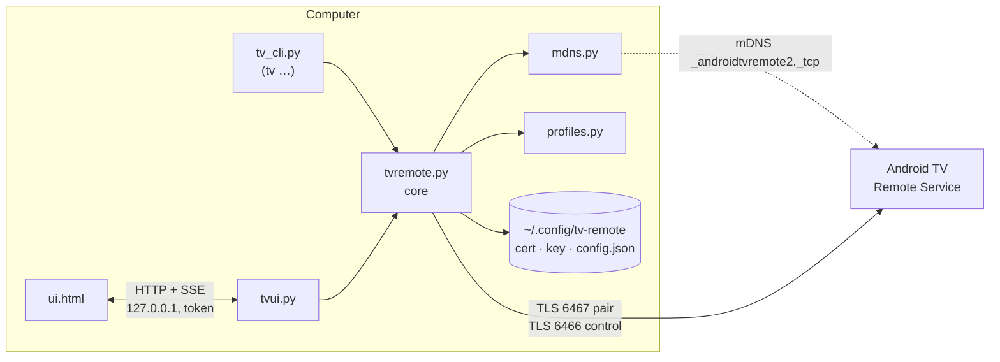
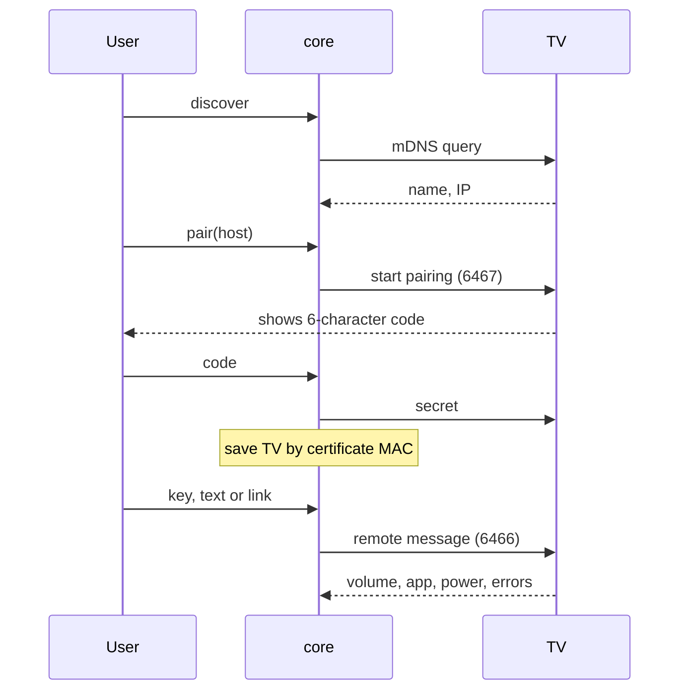

# Architecture

The computer controls the TV with the Android TV Remote protocol v2.
The protocol uses TLS on the local network. ADB is not necessary.



## Sequence



## Files

| File | Function |
|---|---|
| `tvremote.py` | Config, discovery, pairing, connection, features, TV errors |
| `mdns.py` | mDNS browser. Uses the standard library only. |
| `profiles.py` | Tested behavior for each TV model. `DEFAULT` for other TVs. |
| `tv_cli.py` | CLI. `tv check` gives a compatibility report. |
| `tvui.py`, `ui.html` | Local server and page. The server keeps one TV connection open. |

## Rules

- Use only one dependency: `androidtvremote2`. Keep it hash-pinned in `requirements.lock`.
- Keep secrets in `~/.config/tv-remote/` (mode 0600). Do not put them in the repo.
- Keep the UI server on loopback, with a token and a Host check.
- Pair only with private IP addresses.
- In a profile, put only behavior that you tested on a real TV. The TV gives no error for an ignored key.

## Known problems

| Problem | Solution |
|---|---|
| The TV ignores keys before its first state message. | `open_remote()` waits for that message. |
| Many TVs cannot open `market://launch?id=` links. | Use the deep links that the apps declare (`profiles.COMMON_APPS`). |
| The library only logs TV error replies. | `tvremote.launch()` captures the log. |
| `features()` reads a private library field. | Check it after a library upgrade. |

## Test a change

```sh
./tv check
./tv ui
```
