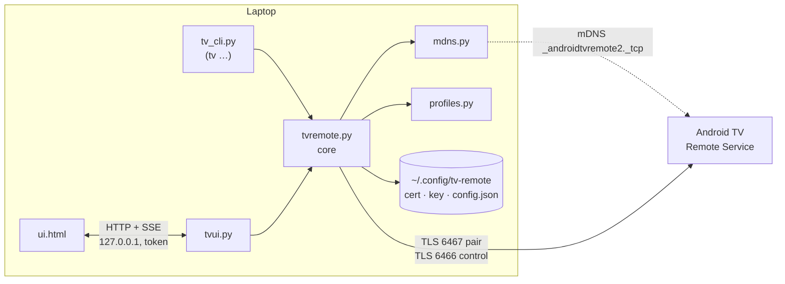
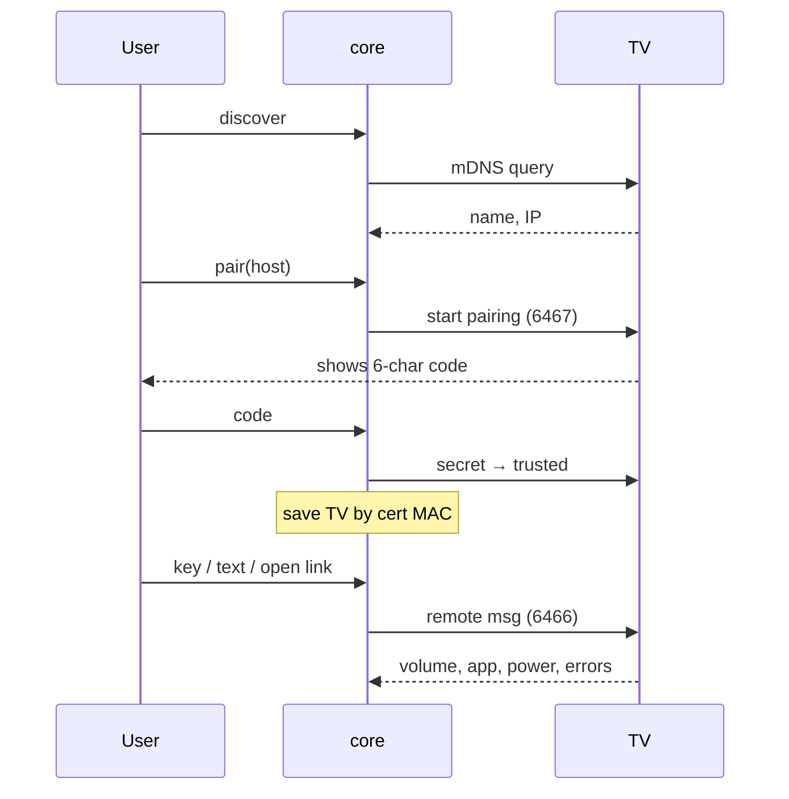

# Architecture

Laptop → Android TV over the **Android TV Remote protocol v2** (TLS, LAN only). No ADB.



## Flows



## Files

| File | Role |
|---|---|
| `tvremote.py` | Config, discover, pair, connect (+relocate on IP change), features, error capture |
| `mdns.py` | Stdlib mDNS browser |
| `profiles.py` | Per-model verified behaviour; `DEFAULT` for unknown TVs |
| `tv_cli.py` | CLI; `tv check` = compatibility report |
| `tvui.py` / `ui.html` | Local server (one persistent TV connection) + single-file page |

## Rules

- **Deps:** only `androidtvremote2` (hash-pinned in `requirements.lock`). Stdlib for everything else.
- **Secrets** live in `~/.config/tv-remote/` (0600), never in the repo.
- **UI server:** loopback only, per-run token, Host check; pairing only to private IPs.
- **Profiles:** only list what was verified on a real TV. The TV gives **no error** for ignored keys.

## Gotchas

- Keys sent before the TV's first state push are dropped → `open_remote()` waits for it.
- `market://launch?id=` has no handler on many TVs → use app-declared deep links (`profiles.COMMON_APPS`).
- Library only *logs* TV error replies → `tvremote.launch()` captures them.
- Feature flags read from a private library attr (`features()`); re-check on library upgrade.

## Verify a change

```sh
./tv check          # end-to-end against your TV
./tv ui             # visual check
```
